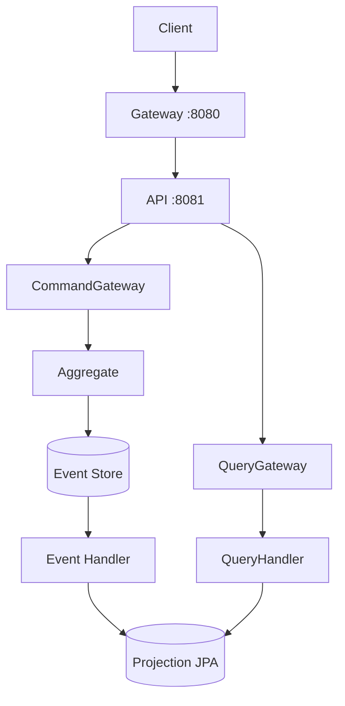

# Compte rendu — Activité pratique N°4 : CQRS et Event Sourcing avec Axon et Spring Cloud

**Établissement :** ENSET — II-BDCC3  
**Module :** Systèmes Distribués et DevOps  
**Professeur :** Mohamed YOUSSFI  
**Étudiant :** À compléter  
**Date :** Novembre 2026

## 1. Introduction

Ce TP illustre la séparation Command/Query (CQRS) et la persistance des changements métier sous forme d'événements (Event Sourcing). L'application proposée gère les comptes bancaires à titre pédagogique. Le sujet Google Classroom demande de reproduire l'exemple présenté dans les vidéos de cours et de pratique. Cette implémentation est une reconstitution fondée sur le thème annoncé ; le détail de la vidéo n'a pas pu être vérifié.

## 2. Objectifs

- Comprendre le rôle des commandes, agrégats, événements et projections.
- Configurer Axon Framework dans Spring Boot et mettre en place un Event Store JPA/H2.
- Définir des règles métier : pas de découvert, montant positif, état valide.
- Exposer des API REST Command et Query.
- Exposer les services derrière Spring Cloud Gateway.
- Tester le scénario bancaire et inspecter l'historique des événements.

## 3. Technologies

| Outil | Utilisation |
|---|---|
| Java 21 | Langage d'implémentation |
| Spring Boot 3.4.5 | Application Web REST et JPA |
| Axon Framework 4.12.1 | Command bus, Query bus, Event Sourcing |
| Spring Cloud 2024.0.1 | Gateway |
| H2 file-based | Event Store JPA + projection (tables distinctes) |
| JUnit 5 / Axon Test | Tests de règles métier |
| Docker Compose | Lancement optionnel |

## 4. Architecture

### CQRS

Les commandes (Create, Credit, Debit, ChangeStatus) passent par `CommandGateway` et `AccountAggregate`. La lecture passe par `QueryGateway` puis `AccountQueryHandler` qui consulte uniquement la projection. Le stockage des événements, lui, est interrogé séparément par l'API d'historique.

### Event Sourcing

L'agrégat n'enregistre pas directement son solde : il applique des événements. Pour reconstruire l'état, Axon rejoue les `AccountCreatedEvent`, `AccountCreditedEvent`, `AccountDebitedEvent`, etc. Une projection dénormalisée sert aux requêtes REST.

## 5. Cas d'utilisation et résultats attendus

| Étape | Commande / requête | Attendu |
|---|---|---|
| 1 | POST création, solde 1000 MAD | HTTP 201, UUID |
| 2 | POST crédit +500 | HTTP 200 |
| 3 | POST débit -200 | HTTP 200 |
| 4 | GET compte | Solde 1300 MAD |
| 5 | GET événements | 3 événements : créé / crédité / débité |
| 6 | POST débit 5000 | Refus HTTP 409 |
| 7 | PATCH statut SUSPENDED, puis crédit | Crédit refusé HTTP 409 |

## 6. Tests fournis

Le fichier `AccountAggregateTest.java` teste la création, le crédit, l'interdiction du découvert, le refus d'un montant nul et l'interdiction de clôturer un compte avec un solde positif. `AccountApiIntegrationTest.java` fournit des tests d'intégration HTTP.

**Statut d'exécution :** non exécutés au moment de préparer cette archive (Maven indisponible et téléchargement des dépendances impossible). Après exécution locale, ajouter ici les résultats observés. Ne pas présenter les résultats attendus ci-dessus comme déjà vérifiés.

## 7. Captures à insérer après exécution

1. Modules Maven importés dans IntelliJ.
2. Démarrage du compte et du Gateway.
3. Postman : POST de création de compte et identifiant retourné.
4. Postman : crédit, débit, liste et détail du compte.
5. Historique JSON de `/api/accounts/{id}/events`.
6. Erreur métier lors du débit supérieur au solde.
7. Exécution des tests JUnit.

## 8. Discussion

L'Event Store est la source de vérité; une projection JPA sert à accélérer la lecture. Une vue de lecture peut devenir momentanément obsolète si sa mise à jour est asynchrone. Ici, le traitement `subscribing` simplifie la démonstration. Pour une architecture industrielle, il faudrait ajouter un stockage durable adapté, des garanties d'idempotence, de la sécurisation, de l'observabilité et des procédures de reconstruction de projection.

## 9. Conclusion

La démonstration illustre l'enchaînement **Commande → Agrégat → Événement → Event Store → Projection → Requête**. L'architecture montre comment CQRS et Event Sourcing apportent un historique auditable tout en séparant les modèles d'écriture et de lecture.

## Références

- https://www.youtube.com/watch?v=AVpyvoJI4Cc
- https://www.youtube.com/watch?v=ZxE9mbvu0og
- https://docs.axoniq.io/axon-framework-reference/4.12/
