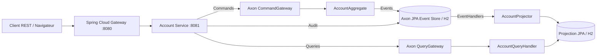

# TP4 — CQRS & Event Sourcing avec Axon et Spring Cloud

**ENSET — Systèmes Distribués et DevOps — Pr. Mohamed YOUSSFI**  
Démonstration pédagogique reconstituée à partir de l'énoncé reçu via Google Classroom le **9 novembre 2026**. Ce projet n'est **pas** une copie vérifiée du contenu vidéo ; l'objectif est de reproduire le principe d'une application CQRS / Event Sourcing.

## Objectif

Développer une application bancaire gérant création, crédit, débit et statut des comptes avec :

- **CQRS** : commandes (`CommandGateway` / agrégat) séparées des requêtes (`QueryGateway` / projection JPA).
- **Event Sourcing** : événements immuables enregistrés par Axon dans une base H2 persistante.
- **Spring Cloud Gateway** : API sur le port 8080, routée vers le service compte sur le port 8081.
- **Règles métier** : montants positifs, pas de découvert, compte actif pour créditer / débiter et clôture seulement si solde nul.
- **Tests** : JUnit + Axon aggregate fixture + tests HTTP avec MockMvc.

## Architecture



Les commandes modifient la source de vérité via les événements, **pas** en modifiant directement les objets `AccountProjection`. Le modèle de lecture est une projection dérivée. Event Store et projection utilisent ici la même instance H2 (tables distinctes), à des fins pédagogiques.

## Prérequis

- Java 21 (JDK), IntelliJ IDEA et Maven
- Facultatif : Docker Desktop

## Démarrage dans IntelliJ (sans terminal)

1. **File → Open** : ouvrir le dossier du projet avec le `pom.xml` racine.
2. Attendre la synchronisation Maven (connexion internet requise au premier démarrage).
3. Exécuter `AccountServiceApplication` (module `account-service`).
4. Exécuter `GatewayApplication` (module `gateway-service`).
5. Ouvrir http://localhost:8081/ pour l'interface, ou utiliser Postman via http://localhost:8080.
6. Pour les tests : clic droit sur `account-service/src/test/java` → **Run Tests**.

Alternative Docker : `docker compose up --build`.

> La passerelle a besoin du service compte démarré. H2 stocke ses données dans `data/` ; les fichiers sont exclus du dépôt par `.gitignore`.

## API REST

Base URL recommandée : `http://localhost:8080`.

| Méthode | URL | Exemple JSON | Rôle |
|---|---|---|---|
| POST | `/api/accounts` | `{ "initialBalance": 1000, "currency": "MAD" }` | Création |
| POST | `/api/accounts/{id}/credit` | `{ "amount": 500 }` | Crédit |
| POST | `/api/accounts/{id}/debit` | `{ "amount": 200 }` | Débit |
| PATCH | `/api/accounts/{id}/status` | `{ "status": "SUSPENDED" }` | Changement statut |
| GET | `/api/accounts` | — | Liste |
| GET | `/api/accounts/{id}` | — | Détail |
| GET | `/api/accounts/{id}/events` | — | Historique Axon |

**Scénario de validation :** créer un compte à 1000 MAD, créditer 500, débiter 200, vérifier **1300 MAD**, puis **3 événements**. Un débit de 5000 doit être refusé avec HTTP **409 Conflict**.

## Concepts clés

1. Une **commande** exprime une intention métier, comme `CreditAccountCommand`.
2. L'**agrégat** `AccountAggregate` vérifie les invariants.
3. `AggregateLifecycle.apply(...)` publie un événement métier.
4. L'**Event Store** conserve la séquence, les `@EventSourcingHandler` permettent de reconstruire l'état.
5. Le `@EventHandler` actualise une projection JPA, interrogée par les **queries**.

Le processeur `subscribing` met à jour le modèle de lecture de manière synchrone dans ce TP. En production, un traitement asynchrone peut introduire une cohérence éventuelle.

## Arborescence

```text
├── pom.xml
├── account-service/        Application REST, Axon, Event Store, projection, tests
├── gateway-service/        Spring Cloud Gateway
├── docker-compose.yml
├── postman/                Collection Postman
├── scripts/                Test de validation avec Python
└── RAPPORT_TP4.md          Compte rendu
```

## Limites et vérification

Les tests fournis doivent **être exécutés localement** : le build Java n'a pas été lancé ici. Aucun résultat de test ou capture d'écran n'est présenté comme vérifié. Ce projet est un **prototype pédagogique**, sans sécurité JWT ni garanties de concurrence, et ne doit pas être utilisé pour des transactions réelles.

## Références

- Cours : https://www.youtube.com/watch?v=AVpyvoJI4Cc
- Démonstration pratique : https://www.youtube.com/watch?v=ZxE9mbvu0og
- Axon Framework 4.12 : https://docs.axoniq.io/axon-framework-reference/4.12/
- Spring Cloud Gateway : https://docs.spring.io/spring-cloud-gateway/reference/
